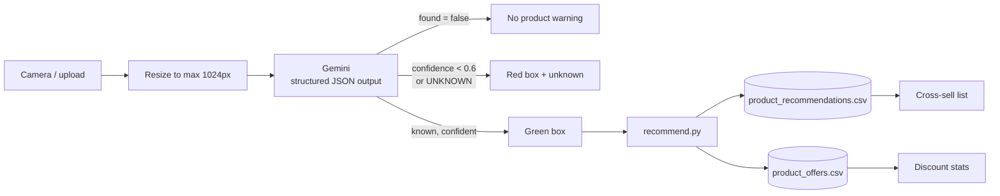

# 🛒 RetailDeep
 
Point a camera at a packet of pasta in a supermarket. A second later the app tells you it's pasta, what usually ends up in the same basket (tomato sauce, 58% of the time), and how often that product goes on discount.
 
Built as part of the DEPI capstone, *Retail Intelligence & Market Basket Analysis Platform* (Data Scientist track). The notebooks and the Power BI side live elsewhere; this repo is only the part you can actually hold a product up to.
 
<p>
  
  
  
  
  
</p>
<!-- Replace with a real screenshot or GIF. A 10 second screen recording of the camera tab does more than any paragraph below. -->
<!--  -->
 
**Live demo:** `<your-app>.streamlit.app` (add the link here)
 
---
 
## What it does
 
1. You take a photo or upload one.
2. Gemini looks at it and picks **one** product from a fixed catalog of 133 items, returns a confidence score and a bounding box.
3. If it's confident enough, the app draws a green box around the product and shows two things from the basket analysis:
   - the products most often bought together with it
   - how often it is sold on discount, and the average discount
If Gemini isn't sure, or the product isn't in the catalog, you get a red box and an "unknown product" message. It does not make up a match. That was the main thing I cared about while building it.
 
Example output for Milk 1L (this is the real output of `answer("P001")`, translated from the app's Egyptian Arabic):
 
```
Product: Milk 1L
 
You might also buy:
- Baladi Bread Pack  (63% of baskets with Milk 1L also have Baladi Bread Pack)
- Eggs 12pc          (49% of baskets with Milk 1L also have Eggs 12pc)
 
This product was sold on discount in 20% of cases, average discount 17%
```
 
The UI itself is in Egyptian Arabic, since that's who it was built for.
 
---
 
## How it works
 

 
The split is deliberate. Gemini only answers *"what is this?"*. It never writes the recommendation text. Everything about what to buy next comes from association rules computed offline on the transaction data, so the suggestions are reproducible and can't be hallucinated.
 
### The recognition step (`app.py`)
 
- The catalog (`ID: name`) is injected into the prompt, and the model is told to copy the ID exactly or return `UNKNOWN`.
- Output is forced into a Pydantic schema through `response_schema`, so there is no regex parsing of free text:
```python
class Result(BaseModel):
    found: bool
    product_id: str
    confidence: float
    box_2d: List[int]   # [ymin, xmin, ymax, xmax], 0-1000
    seen: str           # 3-6 words, shown in the UI
```
- `temperature=0` so the same photo gives the same answer.
- Images are shrunk to 1024px before sending. Phone photos are huge and the model doesn't need them.
- `box_2d` is normalized to 0-1000, so `to_pixels()` converts it back to the real image size, swaps min/max if the model returns them reversed, and drops boxes smaller than 5px.
- A result is accepted only if `confidence >= 0.6` **and** the ID exists in the catalog.
### The recommendation step (`recommend.py`)
 
Small on purpose. It loads two CSVs and answers from them.
 
| Metric | Meaning | How it's used |
|---|---|---|
| **Confidence** | Of the baskets containing A, the share that also contain B | Shown to the user as a percentage. Rules under `0.20` are hidden. |
| **Lift** | How much more often A and B appear together than if they were independent | Kept in the data for analysis; not used for filtering in the app. |
 
A confidence of 0.04 looks like noise, so it's filtered out. Of the 345 rules in the file, only 39 (covering 29 products) pass the 0.20 cutoff. The other products honestly get *"no clear product bought with it"* instead of a weak guess.
 
---
 
## The data
 
| File | Rows | What's in it |
|---|---|---|
| `product_recommendations.csv` | 345 | `Product_ID, Product, Suggested_ID, Suggested, Confidence, Lift` (up to 3 suggestions per product) |
| `product_offers.csv` | 133 | `Product_ID, Lines, Discount_Share, Avg_Discount, Product` |
 
Some numbers worth knowing, straight from the files:
 
- 133 products, about 815k invoice lines in total behind the offer statistics.
- Strongest pairs by lift: **Diapers + Baby Wipes (7.98)**, **Pasta + Tomato Sauce (7.15)**, **Shampoo + Conditioner (7.06)**, **Dish Soap + Sponges (6.33)**.
- Strongest by confidence: **Baladi Bread → Milk 1L (78%)**, **Eggs 12pc → Milk 1L (74%)**, **Chicken 1kg → Rice 1kg (72%)**.
- Discount behaviour is almost flat across the catalog: every product is discounted in roughly 19-22% of sales at an average of about 17%. So the offers panel won't separate products much. That's a property of the dataset, not a bug.
---
 
## Run it locally
 
```bash
git clone https://github.com/<your-username>/<repo-name>.git
cd <repo-name>
 
python -m venv .venv
source .venv/bin/activate        # Windows: .venv\Scripts\activate
pip install -r requirements.txt
```
 
Get a key from [Google AI Studio](https://aistudio.google.com/apikey), then either export it:
 
```bash
export GEMINI_API_KEY="your-key"     # Windows PowerShell: $env:GEMINI_API_KEY="your-key"
```
 
or create `.streamlit/secrets.toml`:
 
```toml
GEMINI_API_KEY = "your-key"
```
 
```bash
streamlit run app.py
```
 
Without a key the app stops and tells you where to put it.
 
### Deploying on Streamlit Community Cloud
 
1. Push the repo to GitHub.
2. New app → pick the repo, main file `app.py`.
3. Advanced settings → Secrets → paste `GEMINI_API_KEY = "..."`.
`.streamlit/secrets.toml` must be in your `.gitignore`. If a key ever lands in a commit, rotate it; deleting the file in a later commit doesn't remove it from history.
 
---
 
## Repo layout
 
```
.
├── app.py                        # Streamlit UI + Gemini call + box drawing
├── recommend.py                  # loads the CSVs, builds the answer text
├── product_recommendations.csv   # association rules (offline output)
├── product_offers.csv            # discount stats per product
└── requirements.txt
```
 
---
 
## Known limits
 
I'd rather list these than have you find them.
 
- **Closed catalog.** It only knows the 133 products in the data. Anything else is "unknown" by design.
- **One product per photo.** If three products are in frame, it picks one main item.
- **Lookalike packs.** Same product in different sizes is the hard case. `Pasta 400g` is meant to cover every pasta shape, and `P035` (Spaghetti 500g) is aliased to `P034` in the code and removed from the prompt catalog, because the model kept splitting them.
- **Recognition quality depends on the label.** Blurry shots and glare lower the confidence, and the app will reject them rather than guess.
- **No evaluation set yet.** I tested by hand with real packs. There's no accuracy number here because I haven't measured one, and I'd rather not invent it.
- **Static rules.** The CSVs are a snapshot. New transactions mean re-running the analysis and replacing the files.
- **API dependency.** Each photo is one Gemini call, so it needs internet and is subject to your quota.
## Ideas for next
 
- A small labelled photo set to report real top-1 accuracy per product.
- Multi-product detection and a suggestion list for the whole basket.
- Use lift as a ranking signal, not just confidence.
- Cache the model response per image hash to save quota.
---
 
## Tech stack
 
Streamlit · Pandas · Pillow · Pydantic · `google-genai` (Gemini vision with structured output)
 
## Context
 
Part of the DEPI capstone. The transaction cleaning, EDA and market basket analysis that produced the two CSVs were done in the main project repo; this app consumes their output.
 
## Author
 
**Sherif** · [GitHub](https://github.com/SherifAzb) · [LinkedIn](https://linkedin.com/in/sherifazb)
 
---
 
<details>
<summary><b>🇪🇬 ملخص بالعربي</b></summary>
<br>
**RetailDeep** تطبيق بسيط: تصوّر أي منتج من السوبر ماركت، Gemini يتعرف عليه من كتالوج فيه ١٣٣ منتج، وبعدين التطبيق يقولك إيه اللي الناس بتشتريه معاه (من تحليل سلة المشتريات) وكام مرة المنتج ده اتباع بخصم.
 
لو الثقة أقل من ٦٠٪ أو المنتج مش في الكتالوج، بيقولك "منتج مش معروف" ومبيخمّنش.
 
للتشغيل: `pip install -r requirements.txt` وحط `GEMINI_API_KEY` وبعدين `streamlit run app.py`.
 
</details>
 
